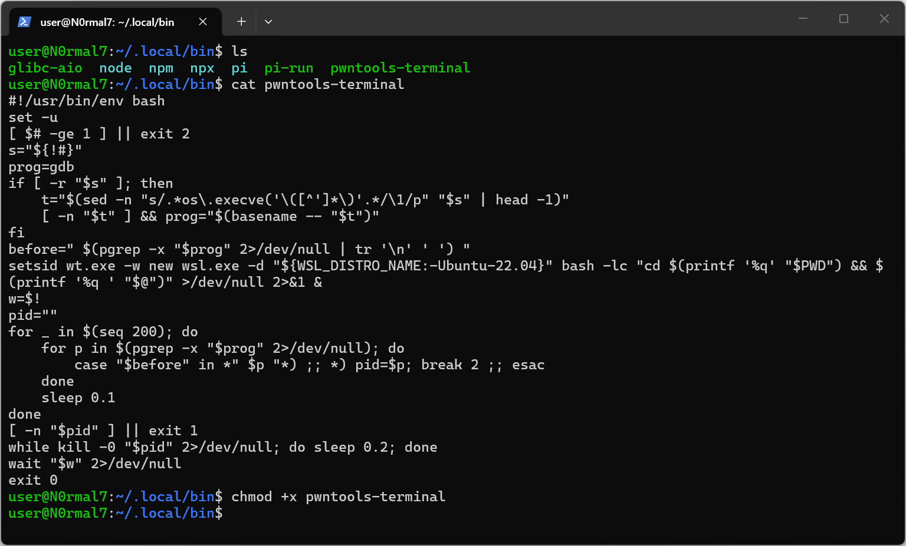
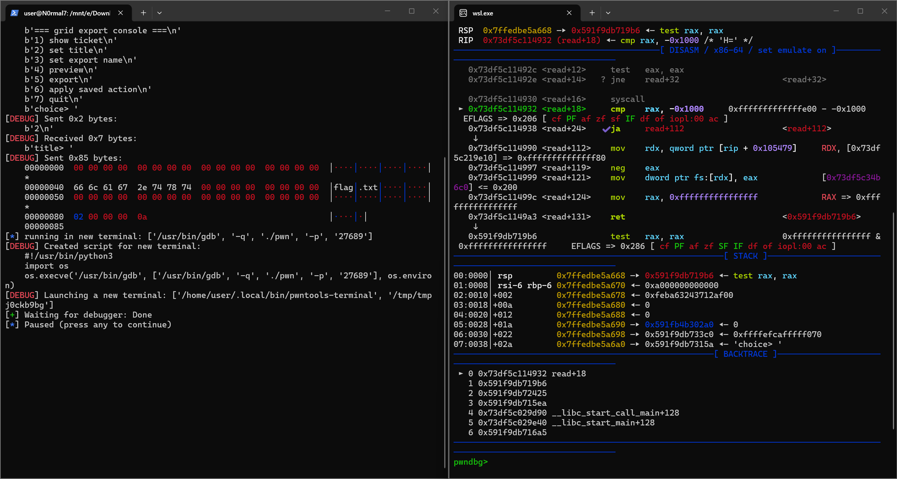

## 前言

笔者在使用WSL运行py脚本进行动调时，发现gdb.attach()无法正常拉起新终端，于是稍微研究了一下如何解决这个问题。以下是简单总结出的方法，仅供参考。

## 实际遇到的问题

以下是gdb.attach()相关代码：

```python
log.info('running in new terminal: %s', cmd)
gdb_pid = misc.run_in_new_terminal(cmd, preexec_fn=preexec_fn)
if pid and context.native:
    gdb_pid = proc.wait_for_debugger(pid, gdb_pid)
```

其中run_in_new_terminal按照从上到下的优先级来进行终端的拉起：

```text
context.terminal            ← 1.显式配置，最高优先级
pwntools-terminal           ← 2.PATH 里的同名命令（官方扩展点）
tmux ($TMUX)                ← 3.有 $TMUX 环境变量时
screen ($STY)
$TERM_PROGRAM (iTerm 等)
x-terminal-emulator ($DISPLAY)  ← 4.有 $DISPLAY 时命中（WSLg 会设置它）
konsole (qdbus)
cmd.exe start               ← 5.只有前面全落空才走
```

脚本使用context.log_level = 'debug'时得调试信息：

```console
[DEBUG] Launching a new terminal: ['/usr/bin/x-terminal-emulator', '-e', '/tmp/tmpXXXX']
```

可以看到，终端的拉起命中了`x-terminal-emulator`分支。

但是在这个分支下，使用的是tilix程序，该程序在运行时会立即崩溃——tilix 需要连接会话 D-Bus，而 WSL 里`/run/user/1000/bus`这个 socket 并不存在。

实际测试如下：

```console
$ tilix -e 'echo hi'
Library libsecret-1.so.0 cannot be loaded...
(tilix:11201): GLib-GObject-WARNING: invalid (NULL) pointer instance
(tilix:11201): GLib-GObject-CRITICAL: g_signal_handlers_disconnect_matched: assertion failed
```

因此，我们需要一个方案，来使gdb.attach()能正常拉起新终端。

## 解决方案

一开始笔者考虑的是直接修好tilix，但发现在WSL下tilix本来就不稳，不如直接放弃tilix，换一个不依赖 X/Wayland/D-Bus 的终端。

于是最终的解决方案是：**利用pwntools-terminal的高优先级，直接绕过x-terminal-emulator，拉起Windows Terminal窗口**。

创建pwntools-terminal文件：

```bash
#!/usr/bin/env bash
set -u
[ $# -ge 1 ] || exit 2
s="${!#}"
prog=gdb
if [ -r "$s" ]; then
    t="$(sed -n "s/.*os\.execve('\([^']*\)'.*/\1/p" "$s" | head -1)"
    [ -n "$t" ] && prog="$(basename -- "$t")"
fi
before=" $(pgrep -x "$prog" 2>/dev/null | tr '\n' ' ') "
setsid wt.exe -w new wsl.exe -d "${WSL_DISTRO_NAME:-Ubuntu-22.04}" bash -lc "cd $(printf '%q' "$PWD") && $(printf '%q ' "$@")" >/dev/null 2>&1 &
w=$!
pid=""
for _ in $(seq 200); do
    for p in $(pgrep -x "$prog" 2>/dev/null); do
        case "$before" in *" $p "*) ;; *) pid=$p; break 2 ;; esac
    done
    sleep 0.1
done
[ -n "$pid" ] || exit 1
while kill -0 "$pid" 2>/dev/null; do sleep 0.2; done
wait "$w" 2>/dev/null
exit 0
```

放置在~/.local/bin路径下：



(记得加执行权限)

把pwntools-terminal文件放在对应目录下后，打开~/.bashrc配置文件，在末尾写入PATH：


（在改配置文件时以防万一可以打个备份，但是这里就不细讲了）

然后执行`source ~/.bashrc`，让改动立即生效。

然后我们就能正常在wsl下使用pwntools + gdb动态调试了。



## 结语

以上为简单总结出的在WSL下配置pwntools+gdb调试方案，如有错误，敬请指正orw